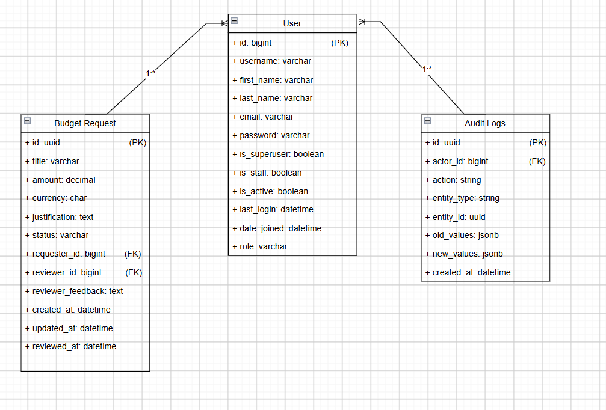

# Budget request workflow

Django serves the pages and enforces roles. React, through Inertia and Vite, renders them. Sign in at [http://localhost:8000](http://localhost:8000).

## Architecture

Three apps sit under `budget_request/apps`: [Loop video](https://www.loom.com/share/014ae0b512634d6a91adac2885205e4e)

- `users` holds the custom user and the `client`, `manager`, and `admin` roles.
- `budget` holds budget requests and audit logs.
- `admin_panel` holds sign-in and the staff screens for users and groups.

Each app keeps HTTP views in `api/`, use cases in `services/`, role rules in `domain/`, and queries in `selectors/`. A client works only with their own requests and can edit or withdraw one while it is pending. A manager approves or rejects pending requests. An admin sees every request, the funding totals, and the activity log, and can delete any request.



`Budget Request.requester_id` and `reviewer_id` are foreign keys to `User`, and so is `Audit Logs.actor_id`. `entity_id` is not. With `entity_type` it is a polymorphic reference: the log names the kind of row (`budget_request`) and stores that row's UUID, without a foreign key to the request table. The log remains after the request is withdrawn or deleted. `old_values` and `new_values` are the before and after snapshot.

## Setup

From the repository root:

```bash
uv sync
uv run budget_request/manage.py migrate
uv run budget_request/manage.py create_dummy_users
uv run budget_request/manage.py runserver
```

`create_dummy_users` creates `client`, `manager`, and `admin`. The shared password is `1234`. The `admin` account is also a Django superuser.

In a second terminal:

```bash
cd budget_request\frontend
npm install
npm run dev
```

Open [http://localhost:8000](http://localhost:8000).
